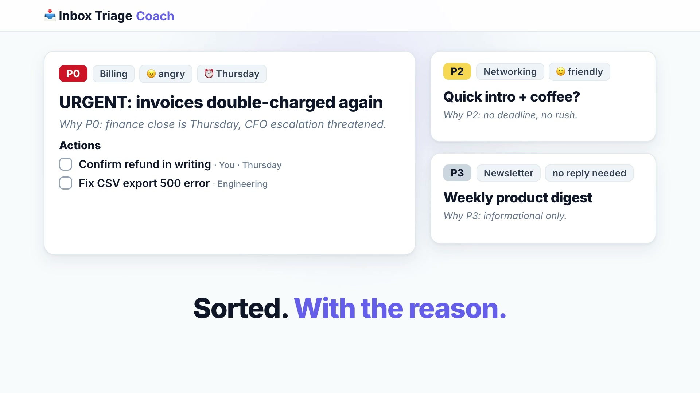

# 📥 Inbox Triage & Reply Coach

**Live:** https://inbox-triage-coach.fly.dev · **Repo:** https://github.com/archie-arya/inbox-triage-coach

[](docs/demo.mp4)

▶ Click the image to watch the 21-second demo (with voiceover).

Inbox Triage & Reply Coach connects to your Gmail and tells you what matters. For each thread you get:
- priority **P0–P3** with the reason
- category, sentiment, sender and deadline
- a concrete action list
- human-sounding reply drafts you can save straight back to Gmail

## How it works
1. **Connect Gmail** (Google sign-in).
2. **Pick threads.** The inbox list has search and quick filters (`is:unread`, `is:important`, `newer_than:2d`, …). You can select up to 10 threads at a time.
3. **Triage + drafts.** Results come back sorted by priority. Generate replies in **professional / warm / firm** tones, with optional instructions such as "offer a 10% credit".
4. **Save as Gmail draft.** The draft is saved in the original thread so you can review it and send it from Gmail. The app **never sends email**.

**Secondary:** you can also paste or upload a thread (`.eml`/`.txt`), or try a built-in sample without signing in.

**Also included:**
- History stays in your browser (localStorage), with JSON/CSV export.
- Dark/light mode, works on mobile.
- Keyboard-friendly (Ctrl/⌘+Enter), with accessibility basics.

## Keys & privacy
- **Visitors never paste API keys.** The LLM keys (Gemini by default; Groq and Ollama are optional) exist only as server-side environment variables or Fly secrets. They are never in the frontend or in git.
- **Gmail scopes:** `gmail.readonly` (list and read the threads you pick) and `gmail.compose` (create drafts only).
- **No database.** OAuth tokens live in an encrypted, HttpOnly cookie. "Disconnect" revokes access with Google.
- **Policy pages:** [Privacy Policy](https://inbox-triage-coach.fly.dev/privacy) at `/privacy` and [Terms of Service](https://inbox-triage-coach.fly.dev/terms) at `/terms`.

### Google sign-in note
The OAuth app is **in production** but **not yet verified by Google**, so users see a "Google hasn't verified this app" screen. To continue: click **Advanced → Go to inbox-triage-coach.fly.dev (unsafe) → Continue**. Unverified apps are limited to 100 users. Full Google verification is optional for later; it includes a CASA security assessment, because the Gmail scopes are restricted. It removes the warning and the cap.

## Architecture
- **Backend:** FastAPI (`backend/app`)
  - LLM layer for Gemini, Groq and Ollama, with automatic Gemini model fallback.
  - Strict JSON prompts with validation and a retry.
  - Per-IP rate limiting, structured errors, CORS and a health check.
  - Gmail OAuth, inbox, thread and draft endpoints.
- **Frontend:** Vite + React + TypeScript + Tailwind (`frontend/`). It builds into `backend/static` and is served by FastAPI, so the whole app runs as one service.

| Method | Path | Purpose |
|---|---|---|
| GET | `/api/health` | health check |
| GET | `/api/providers` | configured LLM providers / models |
| POST | `/api/triage` | `{threads: string[]}` → triage JSON per thread |
| POST | `/api/reply` | `{thread, tones[], instructions?, triage?}` → drafts |
| GET | `/api/me` | Gmail connection status |
| GET | `/api/gmail/threads`, `/api/gmail/threads/{id}` | list / read threads |
| POST | `/api/gmail/drafts` | save a reply as a Gmail draft |
| GET | `/auth/google/login`, `/auth/google/callback`, POST `/auth/logout` | OAuth |

Interactive API docs: `/docs`.

## Run locally
```bash
git clone https://github.com/archie-arya/inbox-triage-coach && cd inbox-triage-coach
cp .env.example .env                      # fill in the values below
python3 -m venv .venv && .venv/bin/pip install -r backend/requirements.txt
(cd frontend && npm install && npm run build)          # outputs to backend/static
cd backend && ../.venv/bin/uvicorn app.main:app --reload --env-file ../.env
# open http://localhost:8000
```
For frontend hot reload, run `cd frontend && npm run dev`. It proxies `/api` to `:8000`.

### Environment variables
| Var | Required | Notes |
|---|---|---|
| `GEMINI_API_KEY` | yes (default provider) | https://aistudio.google.com/apikey |
| `DEFAULT_PROVIDER` | – | `gemini` (default), `groq`, or `ollama` |
| `DEFAULT_MODEL` | – | blank = automatic (`gemini-3.5-flash-lite`, then fallbacks) |
| `GOOGLE_CLIENT_ID` / `GOOGLE_CLIENT_SECRET` | for Gmail | Google Cloud OAuth client of type "Web application" |
| `PUBLIC_URL` | for Gmail | e.g. `http://localhost:8000`; the redirect URI is `PUBLIC_URL/auth/google/callback` |
| `SESSION_SECRET` | yes in prod | long random string (`openssl rand -hex 32`) used to encrypt the session cookie |
| `GROQ_API_KEY` | optional | https://console.groq.com/keys |
| `OLLAMA_BASE_URL` | optional | e.g. `http://localhost:11434` (`ollama pull llama3.1`) |
| `CORS_ORIGINS`, `RATE_LIMIT_PER_MINUTE`, `MAX_INPUT_CHARS` | optional | tuning |

**Google OAuth setup** (one time):
1. Enable the **Gmail API**.
2. On the consent screen, add the scopes `gmail.readonly` and `gmail.compose`, plus the home, privacy and terms URLs and the authorized domain.
3. Create a Web OAuth client with the redirect URI `https://<your-host>/auth/google/callback`. Add `http://localhost:8000/auth/google/callback` too for local development.

### Docker
```bash
docker compose up --build     # http://localhost:8000 (uncomment the ollama service for local models)
```

## Deploy (Fly.io)
`fly.toml` is included. It sets the app `inbox-triage-coach`, a health check on `/api/health`, scale-to-zero, and `PUBLIC_URL`.
```bash
fly secrets set GEMINI_API_KEY=... GOOGLE_CLIENT_ID=... GOOGLE_CLIENT_SECRET=... SESSION_SECRET=$(openssl rand -hex 32) DEFAULT_PROVIDER=gemini
fly deploy --remote-only --ha=false --depot=false
```
Render (`render.yaml`) and a `Procfile` are also included for other hosts.

## License
MIT. See [LICENSE](LICENSE).
